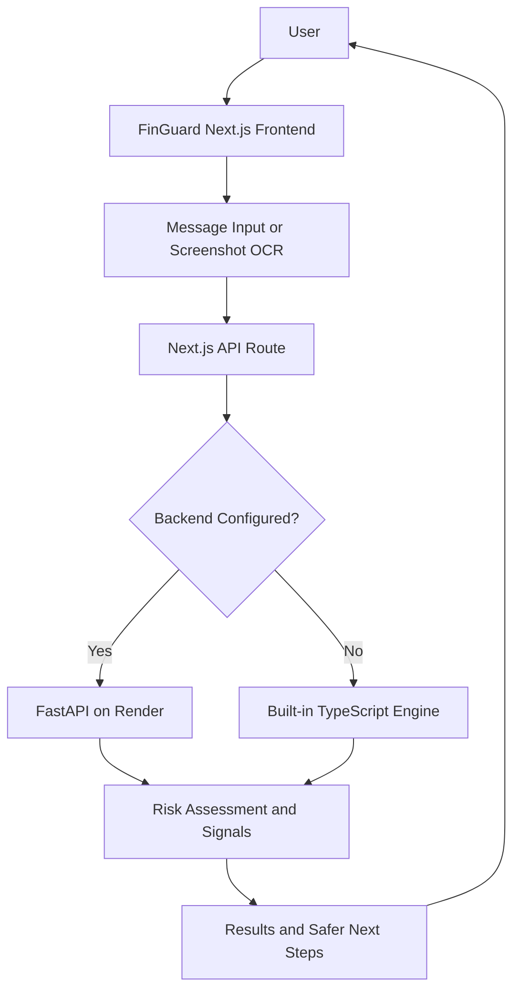

# FinGuard — Digital Payment Scam Awareness

**Understand suspicious messages before you act.**

FinGuard is a digital-payment scam-awareness web application that helps users identify warning signs in suspicious SMS messages, UPI requests, and payment-related emails. It explains potential risk indicators in plain language and recommends safer next steps.

**Live Demo:** https://fin-guard-lac.vercel.app/  
**Backend Health:** https://finguard-dw8l.onrender.com/health  
**Repository:** https://github.com/CodeWithYash-Yashiverse/FinGuard

---

## The Problem

Digital-payment scams often rely on urgency, impersonation, suspicious links, and requests for confidential information. Users may find it difficult to recognize these warning signs, especially when messages appear to come from banks, payment services, or trusted organizations.

FinGuard aims to make scam awareness more accessible by explaining suspicious patterns instead of presenting users with an unexplained risk label.

## Key Features

- **Message analysis:** Analyze suspicious payment-related text.
- **Explainable warning signs:** Highlight indicators such as urgent demands, suspicious links, credential requests, and impersonation patterns.
- **Actionable next steps:** Provide guidance on safer verification practices.
- **Plain-language results:** Make risk explanations easier to understand.
- **Screenshot text extraction:** Use Tesseract.js in the browser to extract text from screenshots before analysis.
- **Input validation:** Reject messages that are too short or exceed the supported length.
- **Privacy-conscious processing:** Analysis responses use `Cache-Control: no-store`; the application code is designed not to persist or log raw submitted messages.
- **Two analysis modes:** A built-in TypeScript analysis engine and an optional Python FastAPI backend.

## Live Application

Visit the deployed application:

**https://fin-guard-lac.vercel.app/**

The frontend is hosted on Vercel, and the Python API is hosted on Render.

## How It Works

1. The user pastes a suspicious message or extracts text from a screenshot.
2. The Next.js API route validates the input.
3. The message is analyzed by the configured detection engine.
4. FinGuard returns a risk assessment, explanatory signals, and recommended next steps.
5. The user can use those indicators to decide how to verify the message safely.

## Architecture



### Technology Stack

| Component | Technology |
|---|---|
| Frontend | Next.js, React, TypeScript |
| Styling and UI | Tailwind CSS, Base UI, Lucide |
| Screenshot OCR | Tesseract.js |
| Backend API | Python, FastAPI |
| Data validation | Pydantic |
| Backend testing | Pytest, HTTPX |
| Frontend hosting | Vercel |
| Backend hosting | Render |

## Getting Started

### Prerequisites

- Node.js compatible with the installed Next.js version
- pnpm package manager
- Python 3.10 or later for the backend
- Git

### 1. Clone the Repository

```bash
git clone https://github.com/CodeWithYash-Yashiverse/FinGuard.git
cd FinGuard/fin-guard-cybersecurity-platform
```

### 2. Install Frontend Dependencies

```bash
pnpm install
```

### 3. Run the Frontend

```bash
pnpm dev
```

Open http://localhost:3000.

By default, the application can use its built-in TypeScript analysis engine.

## Running the Python Backend

Open a second terminal from the `fin-guard-cybersecurity-platform` directory.

### Windows PowerShell

```powershell
cd backend
python -m venv venv
.\venv\Scripts\Activate.ps1
python -m pip install -r requirements.txt
uvicorn app.main:app --host 127.0.0.1 --port 8000
```

If PowerShell blocks virtual-environment activation, use the appropriate activation method for your local security settings, or run the environment's Python executable directly.

### macOS / Linux

```bash
cd backend
python3 -m venv venv
source venv/bin/activate
python -m pip install -r requirements.txt
uvicorn app.main:app --host 127.0.0.1 --port 8000
```

Check the API health endpoint at http://127.0.0.1:8000/health.

Interactive API documentation is available at http://127.0.0.1:8000/docs while the backend is running.

## Connecting the Frontend to FastAPI

Create a `.env.local` file in the `fin-guard-cybersecurity-platform` directory:

```dotenv
FINGUARD_API_URL=http://127.0.0.1:8000
```

Restart the frontend development server after changing environment variables.

The Next.js API route forwards analysis requests to:

```text
POST {FINGUARD_API_URL}/v1/analyze
```

The frontend expects the backend response to match the application's `AnalysisResult` structure.

If the backend URL is not configured, the frontend uses its built-in TypeScript engine. When a configured remote backend is unavailable, the API route returns an error instead of silently fabricating a successful result.

## API Endpoints

| Method | Endpoint | Purpose |
|---|---|---|
| GET | `/health` | Health check |
| POST | `/v1/analyze` | Analyze a message |
| POST | `/api/analyze` | Next.js frontend analysis endpoint |

Example backend request:

```bash
curl -X POST http://127.0.0.1:8000/v1/analyze \
  -H "Content-Type: application/json" \
  -d "{\"message\":\"Urgent: verify your payment account immediately using this link.\"}"
```

The backend accepts a JSON object containing a `message` string. The current implementation validates messages against a length range of 10–5000 characters.

## Testing

### Frontend Checks

Run the available project checks:

```bash
pnpm test:consistency
pnpm test:privacy
pnpm build
```

### Backend Tests

From the `backend` directory with the virtual environment activated:

```bash
python -m pytest tests/ -v
```

Run these commands locally or in CI to verify the current code. Test results should be reported separately; the existence of test scripts does not itself mean all tests pass.

## Deployment

### Frontend — Vercel

- Import the GitHub repository into Vercel.
- Set the Root Directory to `fin-guard-cybersecurity-platform`.
- Use the Next.js framework preset.
- Configure the following environment variable for Production:

```dotenv
FINGUARD_API_URL=https://finguard-dw8l.onrender.com
```

- Deploy and verify the live website.

### Backend — Render

Configure the Render Web Service with:

- **Root Directory:** `fin-guard-cybersecurity-platform/backend`
- **Build Command:** `pip install -r requirements.txt`
- **Start Command:** `uvicorn app.main:app --host 0.0.0.0 --port $PORT`

The deployed backend health endpoint is:

https://finguard-dw8l.onrender.com/health

The backend reads allowed browser origins from `FINGUARD_CORS_ORIGINS`. Update this setting if browser requests need access to the deployed API directly. The current Next.js server-side proxy communicates with FastAPI server-to-server.

Never commit private credentials or production secrets to the repository.

## Privacy and Security

FinGuard is designed to minimize retention of submitted message content:

- The application code does not intentionally persist submitted messages.
- Analysis responses use `Cache-Control: no-store`.
- Screenshot OCR runs in the browser; extracted text is sent for analysis, rather than uploading the original screenshot to the backend.
- The OCR library may download language data from a CDN on first use.

Deployment providers may maintain operational logs and metadata. Review provider logging and retention settings before handling sensitive information. Do not submit real banking credentials, UPI PINs, OTPs, or passwords.

## Limitations and Disclaimer

FinGuard is an awareness and educational tool, not a bank, payment provider, or official fraud-verification service.

- A risk assessment is an indicator, not proof that a message is fraudulent.
- A low-risk result does not guarantee that a message, sender, or link is safe.
- Detection may miss new scam techniques or incorrectly flag legitimate messages.
- Always verify payment requests through official applications, websites, or independently obtained contact details.
- Never share your UPI PIN or OTP with someone who contacts you unexpectedly.

## Project Structure

```text
fin-guard-cybersecurity-platform/
├── app/
│   └── api/analyze/       # Next.js analysis API
├── components/
│   ├── checker/           # Message input and screenshot OCR
│   ├── layout/            # Shared layout components
│   ├── results/           # Risk results and signals
│   └── sections/          # Main page sections
├── lib/
│   ├── analysis/          # Types and TypeScript detection engine
│   └── api-client.ts      # Typed API client
├── backend/
│   ├── app/               # FastAPI application and detector
│   ├── tests/             # Backend tests
│   └── requirements.txt
├── tests/                 # Frontend consistency and privacy checks
├── package.json
└── README.md
```

## Future Improvements

Potential areas for further development include broader detection test coverage, multilingual explanations, improved evaluation against labeled examples, accessibility improvements, and additional security testing.

## Contributing

Contributions and suggestions are welcome. For changes, create a focused branch, explain the problem being addressed, and run the relevant tests and production build before submitting a pull request.

## License

No license information is specified here. Check the repository for an existing license before reusing or redistributing the code.
